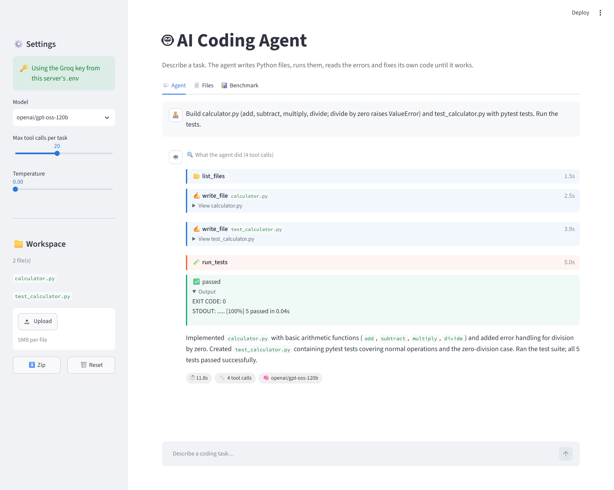
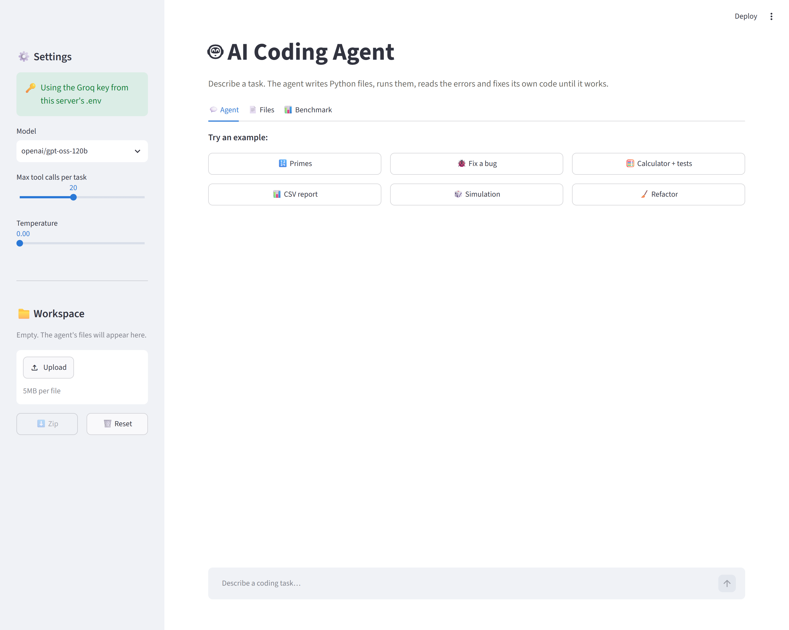
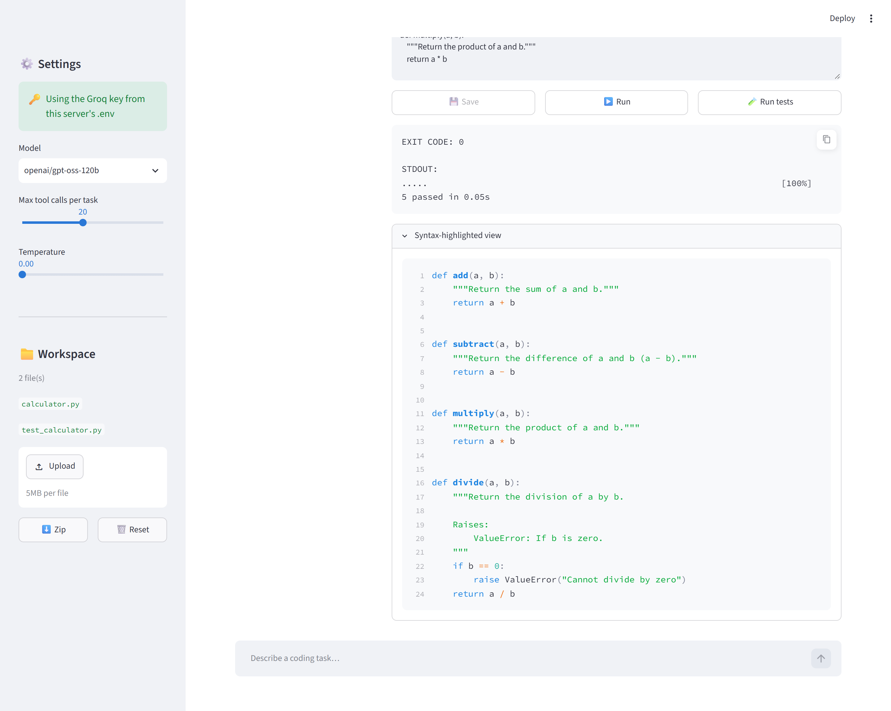
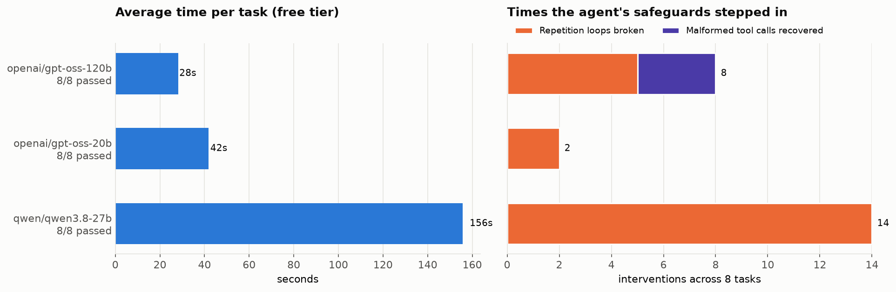
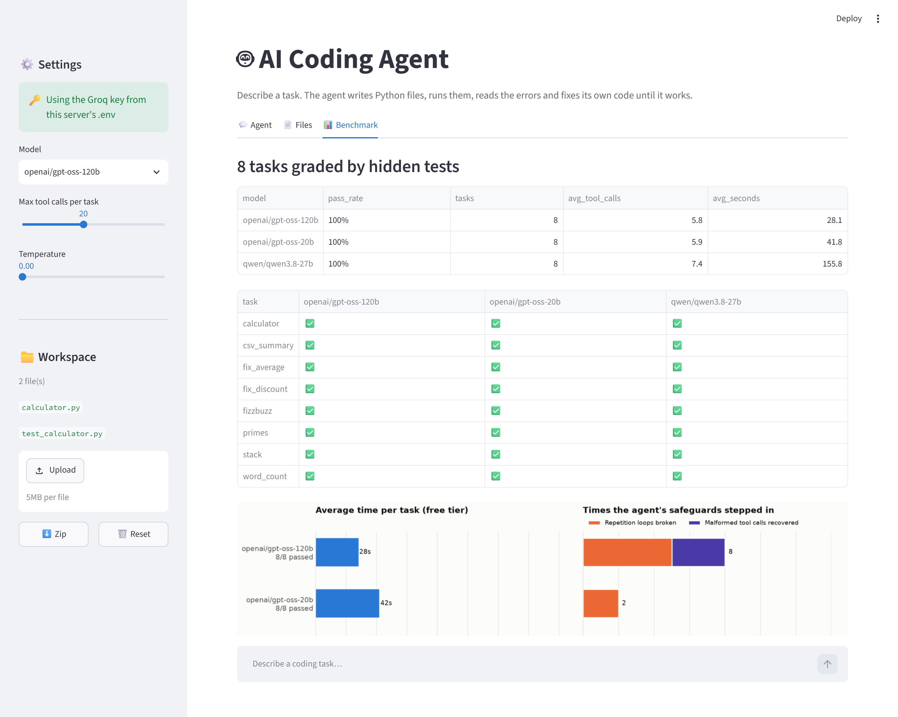

# 🤖 AI Coding Agent

[](https://ai-coding-agentgit.streamlit.app/) 

**▶ Try it live: [ai-coding-agentgit.streamlit.app](https://ai-coding-agentgit.streamlit.app/)** (bring your own free Groq key)

Describe a coding task in plain English. The agent writes Python files, **runs them, reads the tracebacks and fixes its own code** until it works, all in a sandboxed workspace you can browse, edit, run and download. It runs on free LLMs on Groq and is benchmarked on tasks graded by hidden tests.


*Live run: "Build calculator.py with tests and run them." The agent wrote two files, ran pytest, and all 5 tests passed in about 12 seconds.*

| Home | Files tab: edit, run and test any file |
|---|---|
|  |  |

## Features

- **Agent loop with 5 tools:** `write_file`, `read_file`, `list_files`, `run_python`, `run_tests` (pytest).
- **Live timeline:** every tool call streams to the UI as it happens: ✍️ write → ▶️ run → ✅/❌, with collapsible code and output.
- **Workspace:** a separate folder per session. Upload files, browse and edit them with syntax highlighting, run any file or the tests, and download everything as a zip.
- **Multi-turn:** follow-up requests ("now add a CLI", "make it faster") keep the context of earlier turns.
- **Any Groq model:** the model list loads live from your account, with adjustable temperature and step limit.
- **Bring your own key:** in the hosted app each visitor pastes their own free Groq key. It's kept only in their browser session.

## Benchmark

8 tasks: 6 "write new code" and 2 "fix existing code" (a crash and a silent logic bug). Each is graded by **hidden pytest tests copied into the workspace only after the agent finishes**, so the agent can't game them. The tasks are in [`benchmark/tasks.py`](benchmark/tasks.py), with full results in [`reports/benchmark.md`](reports/benchmark.md).

| Model (Groq, free tier) | Passed | Avg tool calls | Avg time | Malformed calls recovered | Loops broken |
|---|---|---|---|---|---|
| `openai/gpt-oss-120b` | **8/8** | 5.8 | **28 s** | 3 | 5 |
| `openai/gpt-oss-20b` | **8/8** | 5.9 | 42 s | 0 | 2 |
| `qwen/qwen3.8-27b` | **8/8** | 7.4 | 156 s | 0 | 14 |



<details><summary>Benchmark tab in the app</summary>


</details>

**What the numbers say**
- **All three models solve every task, but not equally well.** gpt-oss-120b is the fastest and most direct. Qwen needed the loop-breaker 14 times, and on the free tier it hits token-per-minute limits, which is most of its 156 s average.
- **The safeguards matter.** In an earlier run without malformed-call recovery, two gpt-oss-120b tasks ended with a Groq `400 tool_use_failed` error mid-run. With recovery, the agent tells the model and retries; that happened 3 times, and all 3 runs went on to pass.
- **Read 100% carefully.** These are 8 small, well-specified tasks. 100% means the agent does the basics reliably; it doesn't mean it can handle a large codebase. Harder tasks are the next step (see the roadmap).

## How it works

```
task ─► LLM (Groq, tool calling) ─► tool call? ──yes──► run tool in workspace ─► result back to LLM ─┐
             ▲                           │                                                        │
             └───────────────────────────┼────────────────────────────────────────────────────────┘
                                         └─no──► final summary
```

[`coding_agent/agent.py`](coding_agent/agent.py) is a deliberately small, explicit loop instead of a prebuilt agent graph, so it can handle the failure modes seen in practice:

| Problem seen with real models | What the agent does |
|---|---|
| The model repeats the same call with the same arguments (e.g. `list_files` 20× in a row) | After 2 repeats, it appends a note telling the model to do something different |
| The provider rejects a malformed tool call (`400 tool_use_failed`) | It tells the model the call was invalid and lets it retry (up to 3 times) |
| The model writes a tool call as text instead of calling it (the bug in the original classroom notebook) | It detects and flags this in the UI so it doesn't silently "succeed" |
| Rate limits on free tiers | Waits and retries with back-off |
| Runaway runs | A configurable tool-call limit |

The original classroom notebook is in [`notebooks/`](notebooks/00_original_coding_agent_colab.ipynb). Its self-debugging demo failed: Llama 3.3 printed `<function/run_python>…` as text, claimed it had fixed the file, and never did. This project started from that failure.

## Safety

- **Path checks:** every path is resolved and must stay inside the session's workspace (`../`, absolute paths and drive letters are rejected).
- **Limits:** code runs in a subprocess with a 30 s timeout, and output is truncated.
- **No secrets in executed code:** environment variables containing `KEY` or `TOKEN` are stripped from the code the agent runs, and a test checks this.

This prevents accidents, **not deliberate attacks**. For an untrusted public deployment, run the executor in a container or VM, and don't put your own API key in the server's secrets: let visitors use theirs (the default).

## Run locally

```bash
git clone https://github.com/arslanahmedbhutto/ai-coding-agent.git
cd ai-coding-agent
python -m venv .venv
source .venv/bin/activate              # Windows: .venv\Scripts\activate
pip install -r requirements.txt
cp .env.example .env                   # optional: add GROQ_API_KEY (free at console.groq.com/keys)
streamlit run app/streamlit_app.py
```

Without a `.env`, the app asks for a key in the sidebar.

```bash
pytest                                                    # 17 offline tests, no API key needed (scripted fake LLM)
python -m benchmark.run --models openai/gpt-oss-120b      # needs GROQ_API_KEY
python -m benchmark.report
```

## Deploy it (free) on Streamlit Community Cloud

1. Push this repo to GitHub. This repo is deployed at [ai-coding-agentgit.streamlit.app](https://ai-coding-agentgit.streamlit.app/).
2. Go to [share.streamlit.io](https://share.streamlit.io), sign in with GitHub, and click **Create app**.
3. Choose this repo, branch `main`, main file `app/streamlit_app.py`, then click **Deploy**.
4. Don't add a `GROQ_API_KEY` secret for a public app. Visitors paste their own free key in the sidebar.

*Why not Vercel?* Vercel runs short-lived serverless functions (about 10–60 s, read-only disk). This agent needs a long-running Python process that writes files and executes code, which Streamlit Cloud (or Render, Railway or Hugging Face Spaces) provides.

## Project structure

```
├── coding_agent/
│   ├── agent.py        # Tool-calling loop: streaming steps, loop breaker, malformed-call recovery
│   └── workspace.py    # Sandboxed workspace + the 5 tools
├── app/streamlit_app.py
├── benchmark/
│   ├── tasks.py        # 8 tasks with hidden tests
│   ├── run.py          # Run tasks for one or more models
│   └── report.py       # Tables and chart
├── reports/            # benchmark.md, benchmark_results.json, figures/
├── tests/              # Offline tests (scripted fake LLM)
└── notebooks/          # The original classroom notebook
```

## Roadmap

- [ ] Harder benchmark tasks (multi-file refactors, existing repos, more silent logic bugs) and repeated runs for variance
- [ ] Container-based executor for safe public hosting
- [ ] Diff view of the agent's edits
- [ ] Support for more providers (OpenAI-compatible endpoints, local Ollama)

## Tech stack

Python · LangChain (core + Groq) · Groq LLMs (gpt-oss, Qwen) · Streamlit · pytest · GitHub Actions
